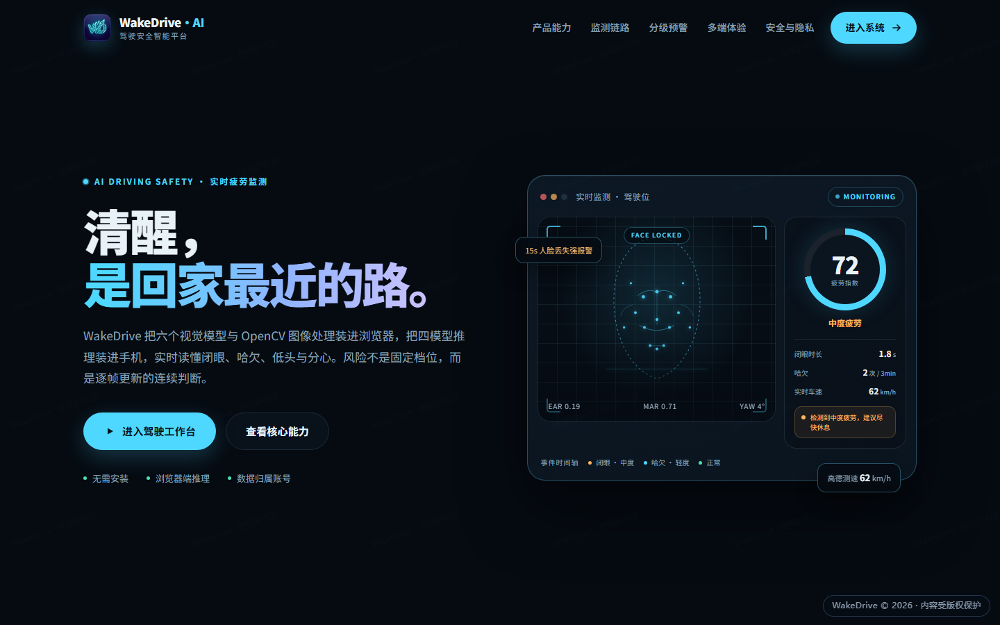
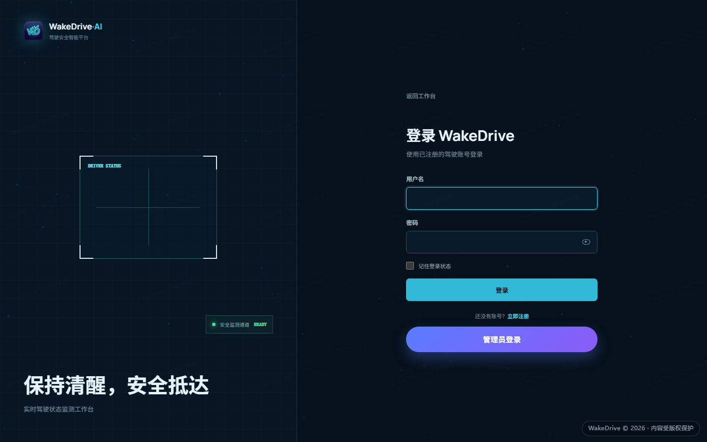

# WakeDrive · AI 疲劳驾驶检测平台

> 覆盖 **Android / iOS / 网页端** 的疲劳驾驶实时检测系统。四个轻量视觉模型全部在设备本地推理，风险评分逐帧更新，驾驶事件、监测报告与统计数据多端同步。

**线上体验**：<https://wakedrive.xyz>



## 目录

- [项目简介](#项目简介)
- [下载](#下载)
- [功能特性](#功能特性)
- [技术栈](#技术栈)
- [仓库结构](#仓库结构)
- [快速开始](#快速开始)
- [检测模型与风险策略](#检测模型与风险策略)
- [部署](#部署)
- [安全与隐私](#安全与隐私)
- [文档索引](#文档索引)
- [常见问题](#常见问题)
- [版权声明](#版权声明)

## 项目简介

WakeDrive 面向真实驾驶场景，通过摄像头画面实时识别驾驶员的疲劳与分心状态：**持续闭眼、频繁哈欠、低头、视线偏离、使用手机、打电话、喝水 / 抬手、长时间未检测到人脸**。

与"固定档位判断"不同，WakeDrive 使用时间窗口对多类信号做**连续风险评分**（0–100），并按轻度 / 中度 / 重度分级预警；同时把驾驶事件（含抓拍图）、监测报告与统计数据保存到账号，Web、Android、iOS 三端使用同一套账号体系与后端服务。

所有检测模型均在**端侧本地推理**（手机端四模型并行、浏览器端模型 + OpenCV 图像处理），画面数据不上传云端，只有风险事件与抓拍快照会在触发时上报，兼顾实时性与隐私。

## 下载

| 端 | 下载 / 使用方式 |
|---|---|
| Android | **[下载 WakeDrive Android v1.2（Debug APK，242.5 MB）](https://github.com/xiao20060730qi-collab/wakedrive-mobile/releases/download/android-v1.2/WakeDrive-Mobile-v1.2-debug.apk)** |
| 网页端 | 直接访问 <https://wakedrive.xyz>，注册账号即可使用，无需安装 |
| iOS | 未提供预编译包，可通过 GitHub Actions 云构建未签名 IPA 后自行签名安装，步骤见 [`ios/README.md`](ios/README.md) |

> Android 安装包为 Debug 构建（全 ABI，未签名发布），默认连接 `https://wakedrive.xyz/api`；安装时需按系统提示允许「安装未知来源应用」。
> 所有版本安装包统一归档在 [Releases](https://github.com/xiao20060730qi-collab/wakedrive-mobile/releases) 页面，可随时查看与下载。

## 功能特性

### 实时监测与连续风险评分

- 四个本地模型覆盖面部、手部、姿态与头部姿态，多维度联合判断；
- 时间窗口加权计算疲劳指数，输出轻度 / 中度 / 重度分级；
- 实时展示疲劳指数、EAR、闭眼时长、哈欠分数、风险等级与本次告警数。

### 分级预警

- 重度疲劳、手机分心、长时间无人脸：高频提示音 + 中文语音提醒；
- 中度疲劳：常规提示音；
- 喝水 / 抬手等轻微行为：温和语音提醒；
- 支持在设置中选择告警风格、音量与语音包，并可试听。

### 驾驶场景联动

- **车速联动**：GPS 速度超过阈值时自动开启监测，行驶中禁止手动关闭；速度为零持续 3 分钟后自动结束监测；
- **人脸丢失**：短时间丢失温和提醒，长时间丢失升级为弹窗 + 循环警报，直到重新检测到人脸；
- **休息点推荐**：重度疲劳时按定位查询附近服务区 / 停车点，并跳转地图导航。

### 事件、报告与统计

- 事件时间轴：按等级、类型筛选，查看抓拍图，标记已处理，导出 CSV；
- 监测报告：结束监测自动生成，包含风险曲线、事件明细与统计摘要；
- 统计分析：今日 / 近 7 天 / 近 30 天的等级分布、类型分布与趋势图。

### AI 驾驶助手

- 基于 DeepSeek 的驾驶安全问答，可结合当前风险数据给出建议；
- 后端未配置 AI 密钥或服务不可用时，前端自动降级为本地规则建议，不影响核心功能。

### 个性化与多端一致

- 个人校准：采集 10 秒正常状态样本，自动推算个人化阈值；
- 阈值、帧数、冷却时间、告警开关、服务器地址等均可配置；
- Web / Android / iOS 使用同一账号，事件、报告与统计数据多端可见。

### 网页端代码保护

公开仓库中的 `website/` 为**受保护构建产物**，包含 JS 混淆加密、域名锁、防调试、防复制、版权水印与全站统一的深色主题；详见 [`website/README.md`](website/README.md)。

## 技术栈

| 端 / 模块 | 技术选型 |
|---|---|
| Android 客户端 | Kotlin、CameraX、原生 Views、MediaPipe Tasks、ONNX Runtime Android、OkHttp、GPS 定位 |
| iOS 客户端 | SwiftUI、MediaPipeTasksVision、ONNX Runtime iOS、AVFoundation、XcodeGen + CocoaPods |
| 网页端 | 原生 HTML / CSS / JavaScript、ONNX Runtime Web、OpenCV.js、MediaPipe Tasks Vision（浏览器端推理） |
| 后端 | Python 3、FastAPI、Uvicorn、SQLite（默认）/ MySQL（可选）、DeepSeek API（AI 助手） |
| 构建 / CI | Gradle 9.6 + AGP 9.4（Android）、GitHub Actions 云端构建 iOS IPA |

## 仓库结构

```text
wakedrive-mobile/
├── app/                  Android 客户端（Kotlin，CameraX + 原生 Views）
├── ios/                  iOS 客户端（SwiftUI，见 ios/README.md）
├── website/              官网 + 网页工作台（受保护构建，见 website/README.md）
├── backend/              Python 后端（FastAPI，见 backend/README.md）
├── .github/workflows/    iOS 云端构建流水线（GitHub Actions）
├── gradle/               Gradle wrapper 配置
├── build.gradle.kts
├── settings.gradle.kts
├── gradle.properties
└── README.md
```

各端详细说明：

| 目录 | 说明文档 |
|---|---|
| `app/` | Android 客户端：CameraX 取帧 + 四模型本地推理 + 分级警报 + 事件上报 |
| `ios/` | iOS 客户端：[`ios/README.md`](ios/README.md)（含 Windows 下云构建 IPA 的完整流程） |
| `website/` | 官网与网页工作台：[`website/README.md`](website/README.md)（含前端保护措施与部署方式） |
| `backend/` | 后端服务：[`backend/README.md`](backend/README.md)（接口分组、环境变量、数据存储） |

## 快速开始

### 网页端

```bash
cd website
python -m http.server 8080
# 浏览器打开 http://localhost:8080/
```

网页端为静态站点，页面可独立预览；实时监测、事件与报告等完整功能需要同时启动后端。`frontend/js/config.js` 在 `localhost` 下会自动把 API 指向 `http://localhost:8000/api`。

### 后端

```bash
cd backend
python -m venv .venv
# Windows: .venv\Scripts\activate
# macOS/Linux: source .venv/bin/activate
pip install -r requirements.txt
python -m uvicorn app:app --host 0.0.0.0 --port 8000
```

首次启动会自动创建空数据库；打开网页端注册新账号即可开始使用。可选环境变量（如 AI 密钥、数据库引擎）见 [`backend/README.md`](backend/README.md)。

### Android

**直接安装**：从 [Releases](https://github.com/xiao20060730qi-collab/wakedrive-mobile/releases) 下载已构建的 Debug APK（见上文 [下载](#下载) 一节）；也可以按下面的步骤本地构建。

环境要求：JDK 17+、Android SDK（compileSdk 37）、Gradle 9.6。

```bash
gradle assembleDebug
# 产物：app/build/outputs/apk/debug/app-debug.apk
adb install -r app/build/outputs/apk/debug/app-debug.apk
```

安装后登录已有账号即可使用；登录页长按底部「服务器：…」可切换后端地址（默认 `https://wakedrive.xyz/api`）。监测需要摄像头权限，车速联动还需要定位权限。

### iOS

```bash
cd ios
brew install xcodegen cocoapods
xcodegen generate
pod install
open WakeDriveMobile.xcworkspace
```

需要 macOS + Xcode 16 / iOS 16+。Windows 环境可通过仓库内置的 GitHub Actions 工作流云端构建未签名 IPA 后侧载，详细步骤见 [`ios/README.md`](ios/README.md)。

## 检测模型与风险策略

### 四个本地模型

| 模型 | 体积 | 运行方式 | 用途 | 触发事件 |
|---|---|---|---|---|
| MediaPipe Face Landmarker | 3.8 MB | MediaPipe Tasks，CPU，逐帧 | 人脸关键点、EAR / MAR、眨眼与张嘴 blendshape | 闭眼、哈欠 |
| YOLO11n（ONNX） | 10.9 MB | ONNX Runtime，640 输入 | 手机可见性、手机贴近面部 | 使用手机 |
| YOLOv8n-pose（ONNX） | 13.5 MB | ONNX Runtime，640 输入，17 关键点 | 手腕—耳朵（通话）、手腕—口鼻（喝水 / 抬手） | 使用手机、喝水 |
| 6DRepNet360（ONNX） | 94 MB | ONNX Runtime，224 输入 + ImageNet 归一化 | 头部 pitch / yaw（低头、视线偏离） | 低头、视线偏离 |

推理节流在 Android / iOS / 网页端保持一致：人脸 300 ms、手机检测 900 ms、姿态 1200 ms、头部姿态 700 ms，串行执行以控制功耗与发热。

### 风险规则

- 眼镜误判缓解：EAR 低于阈值时还需眨眼 blendshape 达到阈值，才计为闭眼；
- 持续闭眼 / 持续张嘴按时长分级，近 60 秒闭眼占比同样参与评级；
- 3 分钟内第 2 次哈欠起升级为中度并加快提醒；
- 车速 > 0.5 m/s 自动开启监测且行驶中禁止关闭，速度为零持续 3 分钟自动结束；
- 事件触发时附带小尺寸 JPEG 抓拍，随事件一起提交后端，用于网页端事件回顾。

## 部署

- **静态站点**：将 `website/` 内容部署到站点根目录，nginx 静态托管；`/api` 反向代理到 FastAPI 服务；
- **后端服务**：Uvicorn 常驻（systemd / 面板进程均可），密钥类配置放在环境变量或受保护的环境文件中，不要写入代码或前端；
- **线上实例**：<https://wakedrive.xyz>，网页端与移动端共用同一套后端接口与账号数据。

具体 nginx / 进程配置示例见 [`website/README.md`](website/README.md) 与 [`backend/README.md`](backend/README.md)。

## 安全与隐私

- **端侧推理**：摄像头画面仅在本地处理，不上传云端；事件触发时才上报小尺寸抓拍快照；
- **账号会话**：登录态使用服务端签发的 Cookie 会话，敏感接口均做服务端校验；
- **密钥管理**：AI 服务密钥、数据库口令等只通过环境变量注入，公开仓库不包含任何生产密钥；
- **前端保护**：公开仓库中的网页端为混淆加密后的受保护构建（域名锁、防调试、防复制、版权水印、统一深色主题）；
- **安全边界**：前端混淆可显著提高逆向与抄袭成本，但浏览器必须执行代码，无法做到绝对不可破解；后端敏感逻辑以服务端校验为准。

## 文档索引

| 文档 | 内容 |
|---|---|
| [`website/README.md`](website/README.md) | 网页端结构、功能、前端保护措施、本地预览与部署 |
| [`ios/README.md`](ios/README.md) | iOS 工程结构、Mac 构建、GitHub Actions 云构建 IPA、侧载说明 |
| [`backend/README.md`](backend/README.md) | 后端接口分组、环境变量、数据存储、部署与健康检查 |

界面截图：

| 官网首页 | 登录页 | 设置页 |
|---|---|---|
|  |  |  |

## 常见问题

**Q：首次运行为什么没有可用账号？**
A：数据库初始为空库，打开网页端或 App 注册新账号即可开始使用。

**Q：网页端打开后提示接口不可用？**
A：本地预览需要同时启动 `backend/`；线上环境请确认 `/api` 反向代理指向后端服务。

**Q：AI 助手没有回答 / 提示服务不可用？**
A：后端需要配置 `DEEPSEEK_API_KEY` 才能启用在线 AI；未配置时前端会自动降级为本地建议。

**Q：模型体积较大，首次打开监测页较慢？**
A：四个模型合计约 120 MB，由浏览器 / App 首次加载后缓存；iOS 端 6DRepNet 首次加载会多花几秒，建议 iPhone X 及以上机型。

**Q：为什么网页端代码是混淆过的？**
A：公开仓库中的 `website/` 为线上构建产物，业务脚本经过混淆加密以保护源码；日常维护请基于私有明文源码重新构建，详见 [`website/README.md`](website/README.md)。

## 版权声明

本项目用于学习、课程设计与毕业设计展示，仓库中的代码、文案与界面设计版权归作者所有。未经许可，请勿将本项目代码或素材用于商业用途或二次分发。引用或参考请注明出处。
