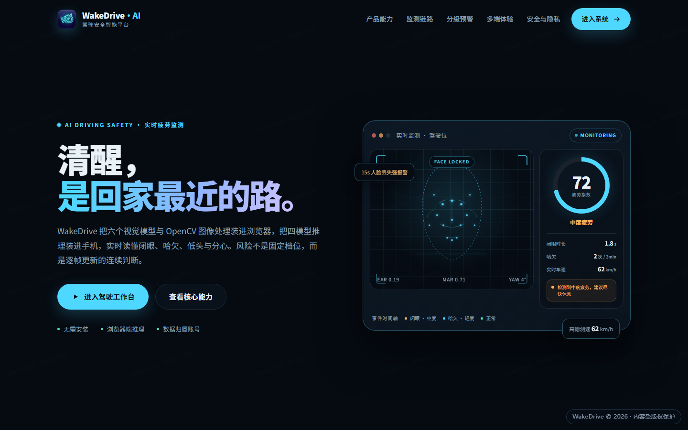
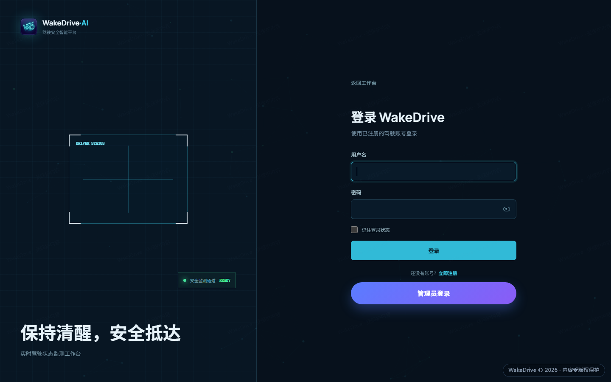

# WakeDrive 网页端 · 官网与网页工作台

> `wakedrive.xyz` 的官网首页与网页工作台前端。基于原生 HTML / CSS / JavaScript 构建，浏览器端运行视觉模型，与 Android、iOS 共用同一套后端接口与账号体系。

本目录是线上版本的**受保护构建产物**：业务 JavaScript 已做混淆加密，并包含域名锁、防调试、防复制等前端保护措施，不包含可直接维护的明文源码。

## 页面一览

| 页面 | 文件 | 功能 |
|---|---|---|
| 官网首页 | `index.html` | 产品介绍、能力说明、驾驶工作台入口、下载入口 |
| 登录 / 注册 | `frontend/login.html`、`frontend/register.html` | 账号登录、注册、记住登录状态 |
| 驾驶工作台 | `frontend/index.html` | 今日事件、待处理告警、风险概览、工程模拟演示入口 |
| 实时监测 | `frontend/monitor.html` | 摄像头 / 本地视频取帧、多模型推理、疲劳指数、事件时间轴 |
| 模型清单 | `frontend/models.html` | 浏览器端模型状态与检测能力说明 |
| 事件记录 | `frontend/alerts.html` | 事件筛选、抓拍查看、标记处理、CSV 导出 |
| 监测报告 | `frontend/reports.html` | 报告列表、风险曲线、事件明细 |
| 统计分析 | `frontend/statistics.html` | 等级分布、类型分布、7 / 30 天趋势 |
| AI 分析 | `frontend/ai.html` | 驾驶安全 AI 问答（服务不可用时本地降级） |
| 系统设置 | `frontend/settings.html` | 阈值、冷却、告警风格、语音包、服务器地址等 |
| 下载页 | `frontend/download.html` | Android / iOS 客户端下载与安装说明 |

## 目录结构

```text
website/
├── index.html              官网首页
├── styles.css              首页样式
├── script.js               首页交互（已混淆）
├── assets/                 首页图片与站点图标
├── frontend/               网页工作台
│   ├── *.html              各功能页面
│   ├── css/                页面样式（深色控制台主题）
│   ├── js/                 业务脚本（已混淆）+ guard.js（前端防护）
│   ├── models/             浏览器端推理模型（ONNX / JSON）
│   └── vendor/             OpenCV.js / WASM、QRCode 等第三方库（保持原样）
└── README.md
```

后端服务见仓库根目录 [`backend/`](../backend/README.md)，部署时由 nginx 将 `/api` 反向代理到 FastAPI 服务。

## 技术要点

- **纯前端实现**：无需构建步骤，静态文件直接部署；
- **浏览器端推理**：ONNX Runtime Web 运行 YOLO 与头部姿态模型，MediaPipe Tasks Vision 运行人脸关键点，OpenCV.js 负责图像预处理；
- **深色控制台设计**：全站统一深色主题（`data-theme="dark"` 锁定，避免不同系统主题下出现黑白混排）；
- **轻量依赖**：CSS / 字体 / 图标本地托管，第三方运行库固定版本放在 `vendor/`；
- **多端一致**：与 Android、iOS 共用账号会话、事件、报告与统计接口。

## 前端保护措施

1. **JavaScript 混淆加密**：全部业务脚本经过字符串数组加密（Base64）、控制流平坦化、十六进制标识符重命名与自防御保护，源码不可直接阅读或复用；
2. **域名锁**：只在 `wakedrive.xyz`、`www.wakedrive.xyz`、`localhost`、`127.0.0.1` 与 `*.qoder.zone` 预览域名下渲染，其他域名显示 403 访问控制页；
3. **主题锁定**：强制全站深色主题，并移除页面与设置中的主题切换入口，保证所有用户看到的视觉一致；
4. **防调试**：开发者工具检测、`debugger` 探针、拦截 F12 / Ctrl+Shift+I/J/C / Ctrl+U / Ctrl+S / Ctrl+P；
5. **防复制**：禁用右键菜单、文本选中、复制 / 剪切与图片拖拽（表单输入不受影响）；
6. **版权水印**：右下角版权角标 + 全页平铺半透明水印，被删除后自动恢复；
7. **防嵌套**：检测被 iframe 嵌套并自动跳出；
8. **托管预览水印清理**：托管平台预览链接自动注入的水印脚本与角标会在运行时被清除。

> 说明：前端混淆可以显著提高逆向与抄袭成本，但浏览器必须执行代码，无法做到「绝对不可破解」。请勿在前端放置任何密钥或敏感凭证——本项目前端不包含任何生产密钥。

## 本地预览

```bash
cd website
python -m http.server 8080
# 打开 http://localhost:8080/
```

- 页面可独立预览；实时监测、事件、报告等完整功能需同时启动 [`backend/`](../backend/README.md)；
- `frontend/js/config.js` 在 `localhost` 下自动把接口指向 `http://localhost:8000/api`；
- 本地预览同样受前端保护脚本约束（域名锁允许 `localhost`）。

## 部署

1. 将本目录内容上传到站点根目录（生产环境为 `/www/wwwroot/wakedrive.xyz`），保持 `index.html`、`styles.css`、`script.js`、`assets/`、`frontend/` 的目录结构；
2. nginx 静态托管站点根目录，并将 `/api` 反向代理到 FastAPI 服务：

```nginx
server {
    server_name wakedrive.xyz www.wakedrive.xyz;
    root /www/wwwroot/wakedrive.xyz;
    index index.html;

    location /api/ {
        proxy_pass http://127.0.0.1:8000/api/;
        proxy_set_header Host $host;
        proxy_set_header X-Real-IP $remote_addr;
        proxy_set_header X-Forwarded-For $proxy_add_x_forwarded_for;
        proxy_set_header X-Forwarded-Proto $scheme;
    }

    location / {
        try_files $uri $uri/ /index.html;
    }
}
```

3. HTTPS 建议使用自动证书（面板 / acme 均可）；静态资源可开启 gzip 与长缓存，`index.html` 建议不缓存以便发版即时生效。

## 维护说明

- 本目录是**混淆后的构建产物**，不要直接修改 `js/` 下的文件——修改后可能触发自防御保护导致脚本失效；
- 日常维护请基于私有明文源码修改后重新构建、再整体替换；
- 发布新版本时请同步更新 HTML 中的静态资源版本号（如 `?v=20261124`），避免浏览器使用旧缓存；
- 修改 `guard.js` 时注意其中包含域名白名单与全站主题锁定逻辑。

## 浏览器兼容性

- 推荐 Chrome / Edge 最新版（桌面端），Safari 16+（macOS / iOS）；
- 实时监测页依赖 `getUserMedia`、WebAssembly 与 WebGL/GPU 加速，建议在 HTTPS 或 `localhost` 下使用；
- iOS Safari 内存限制较严格，首次加载较大模型时若出现卡顿，可先使用事件演示功能。

## 界面截图

| 官网首页 | 登录页 |
|---|---|
|  |  |
